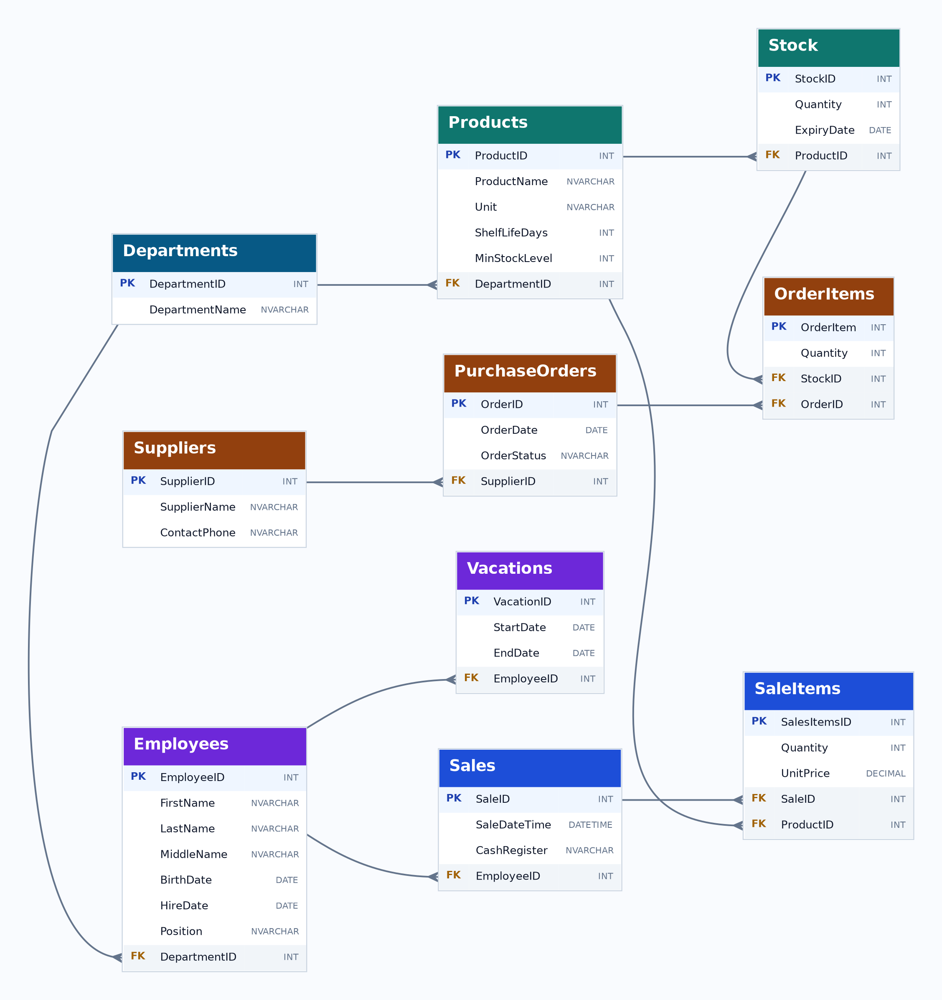

# Система учёта и аналитики продуктового супермаркета

**Курсовой проект | Microsoft SQL Server · T-SQL**

## О проекте

Разработана реляционная база данных для автоматизации учётных процессов продуктового супермаркета и анализа его основных бизнес-показателей.

Система объединяет информацию о товарах, поставщиках, продажах, сотрудниках и складских остатках. На основе этих данных реализованы SQL-запросы для расчёта выручки, среднего чека, анализа продаж по отделам и выявления товаров, требующих пополнения или списания.

**Цель проекта:** создать единую структуру хранения данных, которая позволяет контролировать операционные процессы супермаркета и получать информацию для принятия управленческих решений.

Проект выполнен в рамках университетской курсовой работы с использованием учебных данных.

## Основные возможности

### 1. Учёт продаж и финансовая аналитика

Реализовано хранение информации о продажах с привязкой к кассам, сотрудникам, товарам и отделам.

SQL-запросы позволяют:

- Рассчитывать ежедневную выручку в разрезе отделов.
- Определять количество продаж и объём проданных товаров.
- Вычислять средний чек по каждому отделу.
- Сравнивать средний чек с показателем предыдущего календарного месяца.
- Сопоставлять отделы по финансовым показателям.
- Выявлять записи с нулевой выручкой или количеством продаж.

Основная аналитическая логика реализована через представление `vw_DailySalesSummary`, объединяющее данные из нескольких таблиц.

### 2. Контроль товарных запасов

Для каждого товара хранится минимально допустимый уровень запаса, а для складских записей — количество доступного товара.

Реализована процедура `sp_ShowLowStockTop5`, которая определяет до пяти товаров с наименьшими остатками среди позиций, количество которых не превышает 150% от минимального уровня.

Это позволяет выявлять товары, требующие внимания при планировании закупок.

### 3. Контроль сроков годности

Для складских записей предусмотрен учёт даты окончания срока годности.

Представление `vw_ExpiringProducts` автоматически классифицирует товары по статусам:

- Просрочен.
- Срок годности истекает в ближайшие семь дней.
- В норме.

Дополнительно реализован учебный механизм удаления просроченных складских записей через триггер с использованием курсора.

### 4. Учёт поставщиков и заказов

База данных содержит сведения о поставщиках, заказах и заказанных товарах.

Для заказов предусмотрены статусы: «ожидается», «доставлен», «отменен».

Структура данных позволяет хранить состав заказа и отслеживать его состояние. Автоматическое создание новых заказов пока не реализовано.

### 5. Учёт сотрудников

Реализовано хранение данных о сотрудниках, их должностях, датах трудоустройства, отделах и отпусках.

Дополнительно разработаны механизмы расчёта стажа, определения статуса отпуска, проверки возраста при трудоустройстве и контроля отдельных условий удаления сотрудников.

## Архитектура базы данных

База данных состоит из **10 взаимосвязанных таблиц**.

| Таблица | Назначение |
|---|---|
| `Departments` | Информация об отделах магазина |
| `Products` | Каталог товаров и минимальные уровни запасов |
| `Stock` | Складские остатки и сроки годности |
| `Suppliers` | Данные поставщиков |
| `PurchaseOrders` | Заказы поставщикам и их статусы |
| `OrderItems` | Состав и количество товаров в заказах |
| `Sales` | Информация о продажах, кассах и сотрудниках |
| `SaleItems` | Товары, количество и цены в чеках |
| `Employees` | Сотрудники, должности и даты трудоустройства |
| `Vacations` | Информация об отпусках |

## ER-диаграмма базы данных

Таблицы связаны первичными и внешними ключами: на схеме PK обозначает первичный ключ, FK — внешний ключ. Линии показывают связи «один ко многим»: например, одному отделу (Departments) может соответствовать несколько товаров (Products).

## Аналитическая составляющая

Ключевой частью проекта стала разработка SQL-представления `vw_DailySalesSummary`, предназначенного для ежедневной финансовой сводки.

Реализованы следующие показатели:

| Метрика | Способ расчёта |
|---|---|
| Выручка | `SUM(Quantity * UnitPrice)` |
| Количество продаж | `COUNT(DISTINCT SaleID)` |
| Объём проданного | `SUM(Quantity)` |
| Средний чек отдела | Выручка отдела / число чеков с товарами отдела |
| Средний чек прошлого месяца | Отдельная SQL-функция с агрегацией по чекам |

Для анализа используются объединения нескольких таблиц, группировка, агрегатные функции и фильтрация по датам.

Средний чек рассчитывается на уровне отдела: если чек содержит товары нескольких отделов, для каждого учитывается только стоимость относящихся к нему позиций.

Реализованы запросы, позволяющие сравнивать значения среднего чека по отделам и сопоставлять их с предыдущим месяцем.

**Особенность текущей реализации:** сводка использует последние 30 дней, а сравнительный показатель — предыдущий календарный месяц. Это необходимо учитывать при интерпретации результатов.

## Реализованные SQL-объекты

### Представления — 3

**`vw_DailySalesSummary`**

Формирует ежедневную финансовую сводку по отделам: выручка, количество продаж, проданный объём, средний чек и показатель предыдущего месяца.

**`vw_ExpiringProducts`**

Показывает товары, остатки, сроки годности, количество оставшихся дней и статус пригодности.

**`vw_EmployeesOnVacation`**

Отображает информацию об отпусках сотрудников, их продолжительности, статусах и стаже работы.

### Хранимые процедуры — 3

**`sp_AddEmployee`**

Добавляет нового сотрудника в базу данных с указанием персональных данных, должности и отдела.

**`sp_FindProductByName`**

Осуществляет поиск товаров по части названия и выводит информацию об отделе, количестве, сроке годности и доступности.

**`sp_ShowLowStockTop5`**

Находит товары с низкими запасами, рассчитывает отклонение от установленного минимума и выводит до пяти позиций.

### Пользовательские функции — 3

**`fn_CalculateWorkExperience`**

Рассчитывает стаж сотрудника по дате трудоустройства.

**`fn_GetAverageCheckByDepartment`**

Вычисляет средний чек по выбранному отделу за предыдущий календарный месяц. При расчёте применяется CTE для предварительного определения сумм по чекам.

**`fn_IsEmployeeOnVacation`**

Проверяет, находится ли сотрудник в отпуске на заданную дату.

### Триггеры — 3

**`trg_PreventEmployeeDelete_Simple`**

Обрабатывает удаление сотрудников с учётом их должности, статуса отпуска и наличия недавних продаж.

**`trg_DeleteExpiredProducts_Cursor`**

Реализует удаление просроченных складских записей через представление, используя курсор и связанные операции удаления.

**`trg_CheckEmployeeAge`**

Проверяет корректность дат
